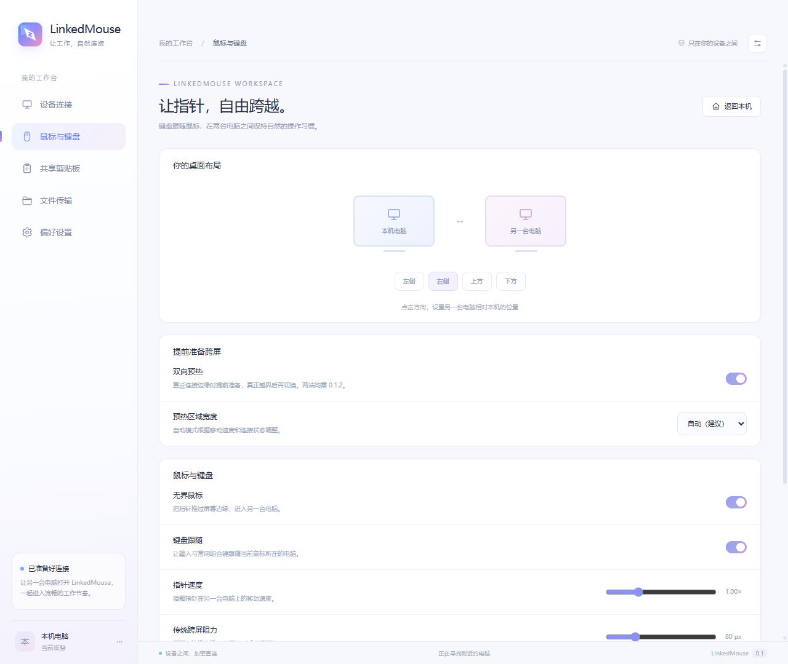
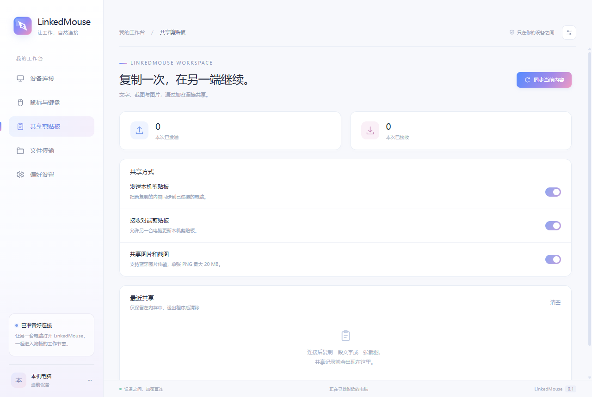
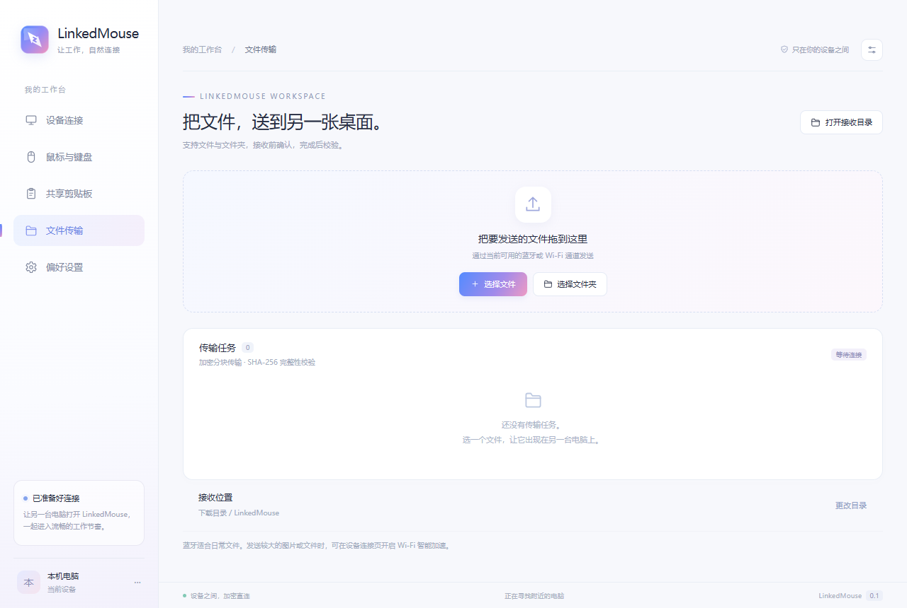

  

<h1 align="center">LinkedMouse</h1>

<strong>两台电脑，一个流畅的工作台。</strong>

蓝牙优先的鼠标、键盘、剪贴板与文件共享工具，面向 Windows 双机开发与日常办公。

  
  
  
  
  

  <a href="https://github.com/Foursettingsun/LinkedMouse/releases/tag/v0.1.2"><strong>下载 v0.1.2</strong></a> ·
  <a href="#第一次使用">连接步骤</a> ·
  <a href="#vpn-与连接方式">VPN 与连接</a> ·
  <a href="https://github.com/Foursettingsun/LinkedMouse/issues">反馈问题</a>

## 下载

两台电脑使用同一版本。安装包与便携版都包含运行环境，无需额外安装 Node.js 或 .NET。

| 文件 | 用途 | 下载 |
| --- | --- | --- |
| Windows 安装包 | 按向导安装到电脑 | [LinkedMouse-0.1.2-setup.exe](https://github.com/Foursettingsun/LinkedMouse/releases/download/v0.1.2/LinkedMouse-0.1.2-setup.exe) |
| Windows 便携版 | 解压后运行 `LinkedMouse.exe` | [LinkedMouse-0.1.2-portable.zip](https://github.com/Foursettingsun/LinkedMouse/releases/download/v0.1.2/LinkedMouse-0.1.2-portable.zip) |
| SHA-256 校验值 | 校验下载文件完整性 | [SHA256SUMS.txt](https://github.com/Foursettingsun/LinkedMouse/releases/download/v0.1.2/SHA256SUMS.txt) |

系统要求：Windows 10 2004（19041）或更高版本 / Windows 11，x64。两端均需支持 Bluetooth LE，至少一端支持 BLE 外围设备广播角色。Wi-Fi Direct 加速另需兼容的无线网卡与驱动。

## 四项核心功能

| 功能 | 可以做什么 |
| --- | --- |
| 无界鼠标 | 指针跨越屏幕边缘后继续操作另一台电脑；支持左右上下位置、速度、边缘阻力与指针锁定。 |
| 键盘共享 | 键盘跟随鼠标，转发常用按键与组合键；提供快捷键返回与断线按键释放。 |
| 共享剪贴板 | 双向共享纯文字、截图与图片；文字上限 256 KB，图片上限 20 MB / 3200 万像素。 |
| 文件传输 | 选择或拖入文件、文件夹；接收确认、进度、取消、重新发送、同名保护与 SHA-256 校验。 |

还提供托盘驻留、开机启动、可信设备自动重连、内存中的最近共享记录，以及连接诊断导出。

## 0.1.2 双向预热与后台输入

**两台电脑都退出旧版后升级到 0.1.2，原配对可保留。**

- 靠近连接边缘时提前准备虚拟入口，当前电脑继续处理输入；真正越界才提交接管。撤回、过期和旧预热包不会移动副机光标。
- 输入源维护副机逻辑位置，采用带序号的位置快照；拥堵时覆盖旧位置，保留最终位置、点击顺序和必要修饰键。
- 返回本机由输入源预测，不等待副机回包；新模式移除固定 250 ms 往返冷却，采用小越界门槛。
- 在“鼠标与键盘”可开启双向预热，宽度支持自动或手动。两端支持新协议时启用完整优化，旧版本保留基础跨屏。
- 关闭窗口隐藏到托盘，最小化/隐藏/失焦后刷新原生监听；独立跟踪物理按钮释放，后台输入不依赖再次点击桌面。
- 增加预热命中/取消、预测返回、位置序号、后台钩子和 Raw Input 注册诊断。

按住鼠标按钮时保持在当前电脑，释放后允许跨机；资源管理器跨机拖放不包含在本版。预热和显示时序仍受真实链路影响，详见[验证记录](docs/VALIDATION.md)和[双机验收步骤](docs/TESTING.md)。

## 第一次使用

1. 在两台电脑上运行 LinkedMouse，并打开 Windows 蓝牙。
2. 在“设备连接”页刷新附近设备，选择另一台电脑发起配对。
3. 核对两端六位数字，在两台电脑上分别点击“数字一致”。
4. 到“鼠标与键盘”页设置另一台电脑在本机的左、右、上或下方。
5. 把指针继续推向对应屏幕边缘，进入另一台电脑；键盘随之切换。
6. 复制文字或截图后，在另一台电脑粘贴；发送文件时打开“文件传输”页。

**连续轻按两次右 Ctrl，立即将鼠标和键盘带回本机。** 也可更换为右 Alt 或右 Shift，或从托盘菜单返回本机。

应用通过自己的 BLE 服务配对，无需在 Windows 蓝牙设置中把另一台电脑添加成“鼠标”。

## VPN 与连接方式

LinkedMouse 以蓝牙作为基础连接。蓝牙发现、配对与传输直接使用 Windows 蓝牙接口，不依赖两台电脑处于同一路由器或同一局域网。

“Wi-Fi 智能加速”默认关闭，可按需开启：先通过可信蓝牙连接协商，尝试可达的本地网络或 Wi-Fi Direct，经过设备身份验证后为图片与文件提供额外通道。无法建立加速通道时继续使用蓝牙。

Wi-Fi Direct 与现有上网连接能否并存，以及 VPN/TUN 是否拦截新接口，取决于两端驱动与网络策略，需要实机验证。当前版本不保证所有 VPN 模式下的 Wi-Fi 直连；蓝牙是主要保障路径。

## 界面预览

原创蓝粉渐变界面与双指针图标。以下图片为界面示意，使用通用设备名称与目录，不表示已完成物理双机连接或性能测试。

鼠标与键盘

共享剪贴板

文件传输

## 预览版状态

v0.1.2 已通过 30 组原生检查、6 项 Node 测试和 8 个双进程回环场景。真实 Electron 主窗口的 5 个页面、最小化与关闭到托盘后的原生通信、键鼠钩子和 Raw Input 注册检查通过，测试中未点击桌面。

两台物理电脑之间的实际蓝牙输入、图片粘贴、不同 VPN/TUN 配置及 Wi-Fi Direct 共存仍需联调。尚未完成与 TwinDesk 的同设备性能对照，不预先宣称优于原版。

当前文件传输入口是“选择文件 / 拖入发送页”。资源管理器跨屏拖文件、文件 Ctrl+C/Ctrl+V、断点续传、锁屏及 UAC 安全桌面控制不包含在此版本中。

## 隐私与问题反馈

- 配对后使用加密会话，并保存可信设备身份。
- 每批文件需要接收确认，同名项目保留原文件。
- 剪贴板最近记录保存在内存，退出后清除；已标记的敏感剪贴板内容会跳过。
- 诊断导出不包含剪贴板正文或私钥。

反馈请使用 [Issues](https://github.com/Foursettingsun/LinkedMouse/issues)，注明两端系统版本、蓝牙型号、VPN 模式及复现步骤。可附“偏好设置 → 导出诊断”生成的文件，提交前检查其中的设备名称、网络地址和文件路径。

## 许可与来源

应用遵循 [GNU GPL v3.0](LICENSE)。输入模块包含 [TwinDesk](https://github.com/InukaAsith/TwinDesk) 与 [Beamer](https://github.com/kalkman-code/beamer) 的贡献，见 [第三方声明](THIRD_PARTY_NOTICES.md)。

本仓库的 Git 提交仅用于发布介绍、图片和许可说明。对应本版本的完整源码、构建脚本与依赖清单以 [Release 源码压缩包](https://github.com/Foursettingsun/LinkedMouse/releases/download/v0.1.2/LinkedMouse-0.1.2-source.zip) 提供；源码不展开提交到 Git 仓库。
