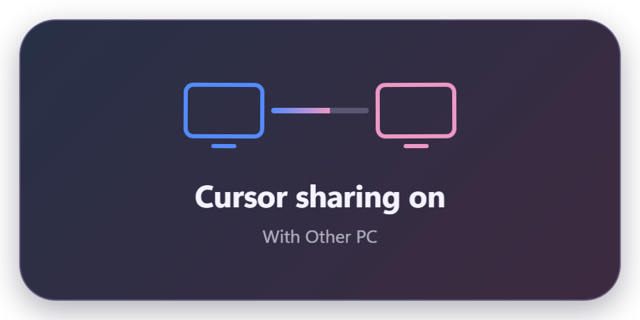

  

<h1 align="center">LinkedMouse</h1>

<strong>两台电脑，一个流畅的工作台。</strong>

蓝牙优先的鼠标、键盘、剪贴板与文件共享工具，面向 Windows 双机开发与日常办公。

  
  
  
  
  

  <a href="https://github.com/Foursettingsun/LinkedMouse/releases/tag/v0.1.7"><strong>下载 v0.1.7</strong></a> ·
  <a href="#第一次使用">连接步骤</a> ·
  <a href="#vpn-与连接方式">VPN 与连接</a> ·
  <a href="https://github.com/Foursettingsun/LinkedMouse/issues">反馈问题</a>

## 下载

两台电脑使用同一版本。安装包与便携版都包含运行环境，无需额外安装 Node.js 或 .NET。

| 文件 | 用途 | 下载 |
| --- | --- | --- |
| Windows 安装包 | 按向导安装到电脑 | [LinkedMouse-0.1.7-setup.exe](https://github.com/Foursettingsun/LinkedMouse/releases/download/v0.1.7/LinkedMouse-0.1.7-setup.exe) |
| Windows 便携版 | 解压后运行 `LinkedMouse.exe` | [LinkedMouse-0.1.7-portable.zip](https://github.com/Foursettingsun/LinkedMouse/releases/download/v0.1.7/LinkedMouse-0.1.7-portable.zip) |
| SHA-256 校验值 | 校验下载文件完整性 | [SHA256SUMS.txt](https://github.com/Foursettingsun/LinkedMouse/releases/download/v0.1.7/SHA256SUMS.txt) |

系统要求：Windows 10 2004（19041）或更高版本 / Windows 11，x64。两端均需支持 Bluetooth LE，至少一端支持 BLE 外围设备广播角色。Wi-Fi Direct 加速另需兼容的无线网卡与驱动。

## 四项核心功能

| 功能 | 可以做什么 |
| --- | --- |
| 无界鼠标 | 指针跨越屏幕边缘后继续操作另一台电脑；支持左右上下位置、速度、边缘阻力与指针锁定。 |
| 键盘共享 | 键盘跟随鼠标，转发常用按键与组合键；提供快捷键返回与断线按键释放。 |
| 共享剪贴板 | 双向共享纯文字、截图与图片；文字上限 256 KB，图片上限 20 MB / 3200 万像素。 |
| 文件传输 | 选择或拖入文件、文件夹；接收确认、进度、取消、重新发送、同名保护与 SHA-256 校验。 |

还提供托盘驻留、开机启动、可信设备自动重连、内存中的最近共享记录，以及连接诊断导出。

## 0.1.7 管理员窗口、入屏手感与双向提示

**两台电脑都从托盘退出旧版，再启动 0.1.7；在“鼠标与键盘”确认管理员输入助手已启用，并允许 Windows 的 UAC 请求。** 配对和个人设置保留。

- 管理员输入助手独立处理鼠标、键盘与特效；连接、剪贴板、文件和设备身份继续由普通权限核心处理。用于任务管理器等管理员窗口，助手异常时回收本机输入并保留连接；取消 UAC 后可在设置中重试。
- 入屏仍从相邻边缘起步，首个受限步后，新移动立即按指针倍率作用，旧位置误差另行收敛，减少主→副刚出现时的粘滞；不补放确认前积压的普通位移。
- “跨屏阻力”在预热和普通跨屏中统一生效，可调为 0。旧版默认预热模式迁移为此前实际生效的 4，避免突然套用界面旧值 80；原值保留用于迁移记录。
- 双向进入/离开光晕在定位确认后播放，冷启动首个可见帧单独计时；预热提前准备绘制资源但不显示，接管后 1 秒拖尾保持。
- 加入原版英文提示：`Using {Device}`、`{Device} is using {This PC}`、`Back on {This PC}` 和 `Cursor sharing on/off`，使用蓝粉色，不抢焦点；可关闭或在本机预览。紧急返回仍为双击右 Ctrl。
- 修复本地启动器跟随未完成版本、隐藏启动图形进程及继承 Electron 调试环境导致无窗口的问题；完整构建校验后再启动，新版未就绪时明确提示回退版本。再次启动可唤回托盘/最小化窗口。

已通过 59 组核心、15 项 Node、10 个真实双进程回环场景和窗口/提示实显检查；任务管理器 High 权限下的助手、标记移动及钩子检查通过。物理双机 BLE 的实际跨屏手感、长期稳定性和不同 VPN 配置仍需验收，见[验证记录](docs/VALIDATION.md)和[验收步骤](docs/TESTING.md)。

## 第一次使用

1. 在两台电脑上运行 LinkedMouse，并打开 Windows 蓝牙。
2. 在“设备连接”页刷新附近设备，选择另一台电脑发起配对。
3. 核对两端六位数字，在两台电脑上分别点击“数字一致”。
4. 到“鼠标与键盘”页设置另一台电脑在本机的左、右、上或下方。
5. 把指针继续推向对应屏幕边缘，进入另一台电脑；键盘随之切换。
6. 复制文字或截图后，在另一台电脑粘贴；发送文件时打开“文件传输”页。

**连续轻按两次右 Ctrl，立即将鼠标和键盘带回本机。** 也可更换为右 Alt 或右 Shift，或从托盘菜单返回本机。

应用通过自己的 BLE 服务配对，无需在 Windows 蓝牙设置中把另一台电脑添加成“鼠标”。

## VPN 与连接方式

LinkedMouse 以蓝牙作为基础连接。蓝牙发现、配对与传输直接使用 Windows 蓝牙接口，不依赖两台电脑处于同一路由器或同一局域网。

“Wi-Fi 智能加速”默认关闭，可按需开启：先通过可信蓝牙连接协商，尝试可达的本地网络或 Wi-Fi Direct，经过设备身份验证后为图片与文件提供额外通道。无法建立加速通道时继续使用蓝牙。

Wi-Fi Direct 与现有上网连接能否并存，以及 VPN/TUN 是否拦截新接口，取决于两端驱动与网络策略，需要实机验证。当前版本不保证所有 VPN 模式下的 Wi-Fi 直连；蓝牙是主要保障路径。

## 界面预览

原创蓝粉渐变界面与双指针图标。以下图片为界面示意，使用通用设备名称与目录，不表示已完成物理双机连接或性能测试。

双向切换与 1 秒拖尾效果示意

离开端收拢，接管端扩散。下图为 0.1.7 在单机 200% 缩放下的真实控制器与绘制线程回放：左右两块受控区域分别表示两端，并包含返回方向。拖尾图同样来自本机真实合成；这些图片不是物理双机录屏。

原版英文提示 · 蓝粉风格

鼠标与键盘

共享剪贴板

文件传输

## 预览版状态

v0.1.7 已通过 59 组核心、15 项 Node、10 个真实双进程回环，以及真实 Electron 五页、最小化和 20 次关闭到托盘检查。新增本机任务管理器权限/标记移动与采集检查、4 个双向可见特效场景、5 种英文 HUD、窗口启动与唤回检查；16 个透明合成和 21 个实际显隐场景通过。测试范围详见[验证记录](docs/VALIDATION.md)。
